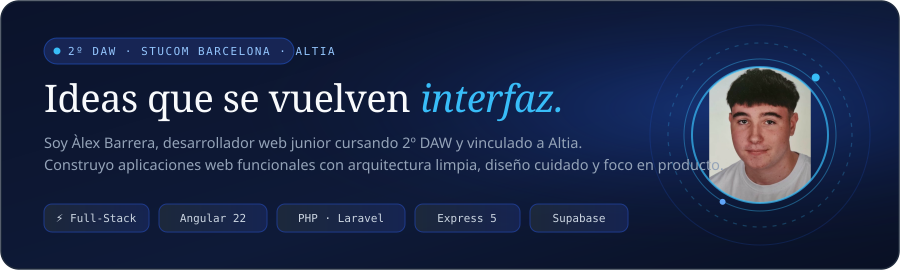
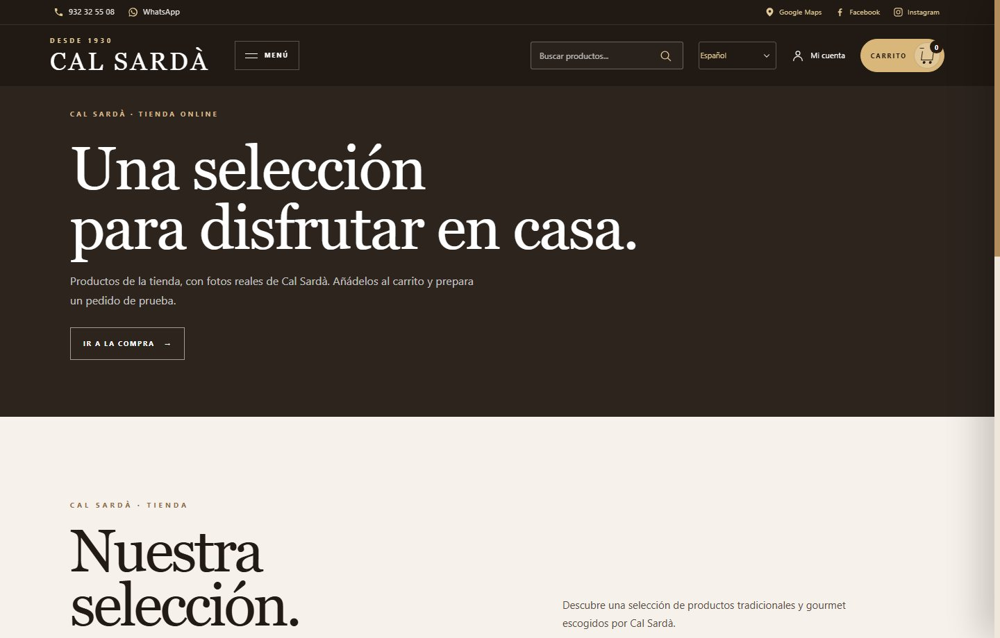
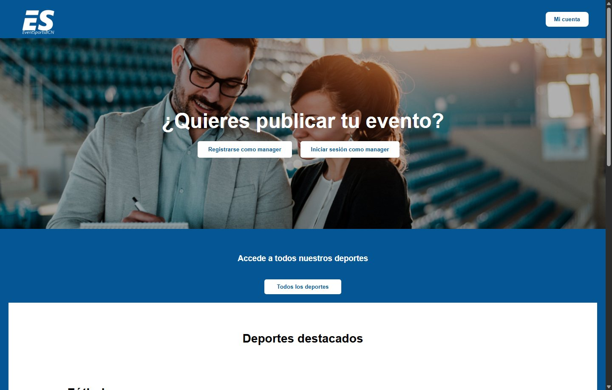

<p align="center">
  
</p>

<p align="center">
  <a href="https://alexbarrera457.github.io">
    
  </a>
  <a href="https://www.linkedin.com/in/%C3%A0lex-barrera-sard%C3%A0-35b088397/">
    
  </a>
  <a href="mailto:salexbarrera@gmail.com">
    
  </a>
</p>

<br>

## `01` — Mi caja de herramientas

> *«Tecnologías que uso para pensar, construir y llevar una idea desde la base de datos hasta el navegador.»*

<table>
  <tr>
    <td width="25%" valign="top">
      <h4>🎨 Frontend</h4>
      <ul>
        <li><b>Angular 22</b> (Signals & SSR)</li>
        <li><b>React</b> & JavaScript ES6+</li>
        <li><b>TypeScript</b></li>
        <li><b>Astro</b> & Tailwind CSS</li>
        <li>HTML5 semántico & CSS3</li>
      </ul>
    </td>
    <td width="25%" valign="top">
      <h4>⚙️ Backend & APIs</h4>
      <ul>
        <li><b>PHP 8</b> (Laravel & Symfony)</li>
        <li><b>Node.js</b> (Express 5)</li>
        <li><b>Java</b></li>
        <li>Arquitectura <b>MVC</b></li>
        <li>APIs RESTful seguras</li>
      </ul>
    </td>
    <td width="25%" valign="top">
      <h4>🗄️ Bases de datos</h4>
      <ul>
        <li><b>MySQL</b> (PDO relacional)</li>
        <li><b>SQLite</b> (modo WAL persistente)</li>
        <li><b>Supabase</b> (PostgreSQL + RLS)</li>
        <li><b>MongoDB</b></li>
      </ul>
    </td>
    <td width="25%" valign="top">
      <h4>🛠️ Herramientas & Calidad</h4>
      <ul>
        <li><b>Git & GitHub</b> (Conventional Commits)</li>
        <li><b>Docker</b> & Compose</li>
        <li><b>Vitest</b> & <b>Playwright</b> (E2E)</li>
        <li>Linux / Bash & Postman</li>
      </ul>
    </td>
  </tr>
</table>

<br>

---

## `02` — Proyectos en curso

<br>

### 🛒 [Cal Sardà](https://github.com/alexBarrera457/Prototipo-Cal-Sarda)
`PROYECTO PERSONAL · 2026` · **E-COMMERCE & DIGITALIZACIÓN CENTENARIA**

<p align="center">
  <a href="https://github.com/alexBarrera457/Prototipo-Cal-Sarda">
    
  </a>
</p>

> Plataforma de comercio electrónico para digitalizar la operativa y catálogo del comercio y colmado centenario Cal Sardà (fundado en 1930 en Barcelona): catálogo de más de 450 referencias gastronómicas, gestión de alérgenos, lotes gourmet y flujo simulado *Click & Collect*.

- 🏛️ **Arquitectura de Monorepo Modular:** Dominio desacoplado del framework mediante contratos compartidos en `@cal-sarda/domain` ([ADR 0001](https://github.com/alexBarrera457/Prototipo-Cal-Sarda/blob/master/docs/adr/0001-modular-monorepo-structure.md)).
- ⚡ **Angular 22 + SSR Express 5:** Renderizado en servidor con hidratación y metadatos dinámicos Open Graph / JSON-LD ([ADR 0002](https://github.com/alexBarrera457/Prototipo-Cal-Sarda/blob/master/docs/adr/0002-deep-modules-architecture.md)).
- 📦 **Catálogo & Cesta Reactiva:** +455 productos reales, clasificación por familias, alérgenos y cesta reactiva gestionada mediante **Signals**.
- 🔒 **Persistencia en Supabase:** Modelo relacional con políticas de seguridad por fila (RLS) ([ADR 0003](https://github.com/alexBarrera457/Prototipo-Cal-Sarda/blob/master/docs/adr/0003-supabase-for-backend-and-migrations.md)).
- 🧪 **Calidad:** Tests unitarios con **Vitest** y tests E2E con **Playwright** cubriendo el embudo de compra completo.

**Stack:** `Angular 22` · `Express 5 SSR` · `TypeScript` · `Domain-Driven` · `Supabase RLS` · `Vitest` · `Playwright`  
👉 **[Explorar repositorio en GitHub ↗](https://github.com/alexBarrera457/Prototipo-Cal-Sarda)** · **[Ver en mi Portfolio ↗](https://alexbarrera457.github.io)**

<br>

---

<br>

### 🤖 [OMNI // NEXUS](https://github.com/alexBarrera457/OmniNexus)
`PROYECTO PERSONAL · 2026` · **CAPA LOCAL DE ASISTENCIA INTELIGENTE**

```text
┌────────────────────────────────────────────────────────────────────────┐
│  OMNI // NEXUS  ·  online  ·  YOUR LOCAL INTELLIGENCE LAYER            │
│  [WEB SEARCH]    [MEMORY / SQLite WAL]    [SAFE CALCULATOR]            │
└────────────────────────────────────────────────────────────────────────┘
```

> Capa local de asistencia inteligente con interfaz web reactiva y backend modular en Express 5. Integra persistencia en SQLite con WAL mode, enrutador de herramientas locales (cálculo seguro, reloj y búsqueda web) y suite de 27 tests automatizados.

- 🧩 **Deep Modules en Backend:** Arquitectura desacoplada en Express 5 (`server.js` con <90 líneas limpias), seguridad HTTP mediante Helmet y modo DEMO offline sin credenciales externas.
- 💾 **Persistencia ACID:** Base de datos SQLite con modo WAL (*Write-Ahead Logging*) para histórico de conversaciones y memoria persistente.
- ⚙️ **Enrutador de Herramientas Seguras:** Ejecución de cálculos y consultas de sistema sin utilizar `eval()`.
- 🧪 **Testing Automatizado:** Suite de 27 pruebas unitarias y de integración con `supertest` y `node:test`.

**Stack:** `Node.js` · `Express 5` · `SQLite (WAL)` · `Deep Modules` · `REST API` · `Automated Tests`  
👉 **[Explorar repositorio en GitHub ↗](https://github.com/alexBarrera457/OmniNexus)** · **[Ver en mi Portfolio ↗](https://alexbarrera457.github.io)**

<br>

---

<br>

### 🏆 [EventSportsBCN](https://github.com/alexBarrera457/ProjectEventSportsBCN)
`PROYECTO ACADÉMICO · 2026` · **GESTIÓN INTEGRAL DE EVENTOS DEPORTIVOS**

<p align="center">
  <a href="https://github.com/alexBarrera457/ProjectEventSportsBCN">
    
  </a>
</p>

> Plataforma web full-stack para el descubrimiento, inscripción y gestión de torneos y eventos deportivos en Barcelona, construida con arquitectura MVC en PHP 8 y control de aforo en tiempo real.

- 👥 **Roles Segregados:** Vistas y privilegios diferenciados entre Deportista (inscripción, perfil) y Organizador (panel de gestión).
- 🎟️ **Control de Aforo en Tiempo Real:** Integridad referencial en base de datos para evitar sobrerreservas de plazas.
- 📊 **Panel de Administración CRUD:** Publicación, edición y supervisión integral de torneos y participantes.
- 🧱 **Arquitectura MVC Limpia:** Consultas preparadas PDO para prevenir inyecciones SQL y filtrado reactivo de eventos en cliente.

**Stack:** `PHP 8` · `MySQL` · `JavaScript` · `Arquitectura MVC` · `PDO` · `Responsive Design`  
👉 **[Explorar repositorio en GitHub ↗](https://github.com/alexBarrera457/ProjectEventSportsBCN)** · **[Ver en mi Portfolio ↗](https://alexbarrera457.github.io)**

<br>

---

## `03` — Trayectoria & Experiencia

<table>
  <tr>
    <td width="28%"><b>2026 — Actualidad</b><br><sub>En activo</sub></td>
    <td>
      <b>Altia — Desarrollador Web Junior</b><br>
      Vinculación profesional y desarrollo web en entorno tecnológico empresarial, aplicando estándares de ingeniería, buenas prácticas y trabajo en equipo.
    </td>
  </tr>
  <tr>
    <td width="28%"><b>2025 — 2027</b><br><sub>Formación reglada</sub></td>
    <td>
      <b>Stucom Barcelona — 2º DAW</b><br>
      Grado Superior en Desarrollo de Aplicaciones Web. Formación práctica enfocada en desarrollo full-stack, arquitecturas limpias y bases de datos.
    </td>
  </tr>
  <tr>
    <td width="28%"><b>2025</b><br><sub>Certificación</sub></td>
    <td>
      <b>Cibernarium Barcelona — Especialización en IA</b><br>
      Certificaciones en <i>Python y Hugging Face Transformers</i> y <i>Prompting y Cartografía de herramientas de Inteligencia Artificial</i>.
    </td>
  </tr>
  <tr>
    <td width="28%"><b>2024</b><br><sub>Comercio local</sub></td>
    <td>
      <b>Cal Sardà — Dependiente en tienda física</b><br>
      Atención al cliente y gestión de encargos en comercio centenario. Experiencia que sentó las bases para el diseño y desarrollo de su plataforma de software e-commerce.
    </td>
  </tr>
</table>

<br>

---

## `04` — Actividad en GitHub

<div align="center">
  
  
</div>

<br><br>

<div align="center">
  <h3><em>«Hagamos algo interesante.»</em></h3>
  <p>¿Tienes un proyecto en mente o quieres compartir ideas de ingeniería web?</p>
  <p>
    <a href="mailto:salexbarrera@gmail.com"><b>Escríbeme por email</b></a> · 
    <a href="https://www.linkedin.com/in/%C3%A0lex-barrera-sard%C3%A0-35b088397/"><b>Conecta en LinkedIn</b></a> · 
    <a href="https://alexbarrera457.github.io"><b>Visita mi portfolio web</b></a>
  </p>
  <br>
  <sub>Barcelona · Hecho con dedicación</sub>
</div>
